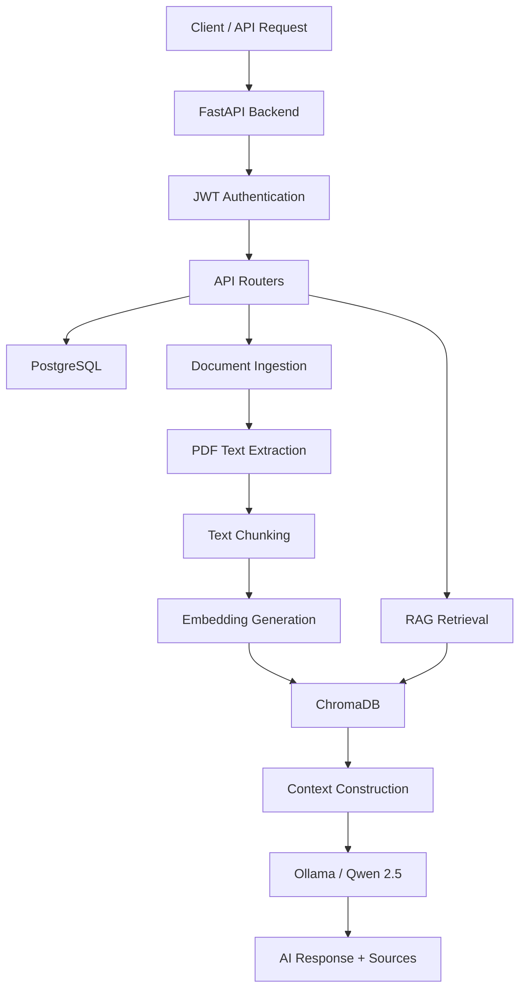

# NEXUS — AI-Powered Enterprise Knowledge Assistant

NEXUS is a modular AI platform designed to connect enterprise knowledge with large language models (LLMs), retrieval-augmented generation (RAG), and backend services.

The current implementation allows users to authenticate, manage conversations, upload PDF documents, retrieve relevant information through semantic search, and receive AI-generated answers grounded in their documents.

The project is being developed incrementally, with an emphasis on modular architecture, data isolation, reliability, and practical AI engineering.

## Key Features

- **Authentication:** User registration, login, password hashing, and JWT-based authentication.
- **Conversation Management:** Create and retrieve conversations and messages.
- **PDF Document Ingestion:** Upload and process PDF documents.
- **Text Processing:** Extract PDF text and split it into smaller overlapping chunks.
- **Semantic Search:** Generate embeddings using Sentence Transformers and store them in ChromaDB.
- **RAG Pipeline:** Retrieve relevant document chunks and provide context to an LLM.
- **LLM Integration:** Generate responses using Ollama and Qwen 2.5.
- **Source Attribution:** Return document identifiers, filenames, and page numbers with answers.
- **Document Management:** List and delete indexed documents.
- **Data Isolation:** Scope document retrieval and management to the authenticated user.
- **Automated Testing:** Backend functionality covered by pytest.

## Technology Stack

| Category | Technologies |
|---|---|
| Language | Python 3.13 |
| Backend | FastAPI |
| Database | PostgreSQL |
| ORM | SQLAlchemy |
| Authentication | JWT, Password Hashing |
| LLM Runtime | Ollama |
| Language Model | Qwen 2.5 3B |
| Embeddings | Sentence Transformers |
| Embedding Model | all-MiniLM-L6-v2 |
| Vector Database | ChromaDB |
| PDF Processing | pypdf |
| Testing | pytest |

## System Architecture



## RAG Workflow

The document question-answering pipeline follows these steps:

1. A user uploads a PDF document.
2. The backend extracts text from the PDF.
3. Extracted text is divided into smaller chunks.
4. Sentence Transformers generates vector embeddings.
5. Embeddings and document metadata are stored in ChromaDB.
6. A user submits a question.
7. The question is converted into an embedding.
8. ChromaDB retrieves semantically relevant chunks belonging to that user.
9. Retrieved context is passed to the LLM through Ollama.
10. The LLM generates an answer using the supplied context.
11. The API returns the answer along with its document sources.

NEXUS also applies a retrieval distance threshold to help exclude irrelevant results and avoid unsupported answers.

## Project Structure

```text
nexus/
│
├── backend/
│   ├── main.py
│   ├── database.py
│   ├── db_session.py
│   ├── dependencies.py
│   ├── models.py
│   ├── schemas.py
│   ├── security.py
│   │
│   ├── routers/
│   │   ├── auth.py
│   │   ├── conversations.py
│   │   └── documents.py
│   │
│   ├── services/
│   │   ├── auth_service.py
│   │   ├── conversation_service.py
│   │   ├── ollama_service.py
│   │   └── rag/
│   │       ├── document_loader.py
│   │       ├── document_processor.py
│   │       ├── embedding_service.py
│   │       ├── ingestion_service.py
│   │       ├── retrieval_service.py
│   │       ├── rag_service.py
│   │       ├── text_splitter.py
│   │       └── vector_store.py
│   │
│   └── tests/
│
├── docs/
├── storage/
├── .env.example
├── .gitignore
├── pyproject.toml
└── README.md
```

## Getting Started

### Prerequisites

- Python 3.13
- PostgreSQL
- Ollama
- Git

### 1. Clone the repository

```bash
git clone https://github.com/gunjancharmode/nexus.git
cd nexus
```

### 2. Create a virtual environment

```bash
python -m venv .venv
```

Activate it on Windows:

```powershell
.\.venv\Scripts\Activate.ps1
```

### 3. Install dependencies

```bash
pip install -e .
```

### 4. Configure environment variables

Create your local `.env` file using `.env.example` as the reference.

Configure the PostgreSQL connection and other required application settings.

### 5. Start Ollama

Install Ollama and pull the model:

```bash
ollama pull qwen2.5:3b
```

Ensure the Ollama service is running.

### 6. Start the FastAPI application

```bash
uvicorn backend.main:app --reload
```

### 7. Open API documentation

Visit:

http://127.0.0.1:8000/docs

## API Capabilities

| Module | Endpoint | Description |
|---|---|---|
| Health | `GET /health` | Application health check |
| Authentication | `POST /api/v1/auth/register` | Register a user |
| Authentication | `POST /api/v1/auth/login` | Authenticate a user |
| Documents | `POST /api/v1/documents/upload` | Upload a PDF |
| Documents | `GET /api/v1/documents/` | List user documents |
| Documents | `POST /api/v1/documents/ask` | Ask document-related questions |
| Documents | `DELETE /api/v1/documents/{document_id}` | Delete a document |

Conversation endpoints are also available under `/api/v1/conversations/`.

## Running Tests

Run the automated test suite:

```bash
pytest -v
```

The project has reached **13 passing tests** in its current development state.

## Development Roadmap

The following capabilities are planned for future iterations:

- Structured business data analysis using Pandas and NumPy.
- Machine learning model development and evaluation.
- Advanced RAG improvements and retrieval evaluation.
- LLM quality, latency, and cost monitoring.
- Controlled AI workflow execution with human approval.
- Docker-based deployment.
- AWS deployment and infrastructure.
- Expanded security and integration testing.

These are planned capabilities, not claims about the current implementation.

## Engineering Principles

- Modular monolith architecture.
- Separation of API, service, and data-access responsibilities.
- Secure authentication and user-level data boundaries.
- Incremental implementation and testing.
- Evidence-based evaluation of AI responses.
- Clear documentation and maintainable code.

## Project Status

**Current stage: Working backend and RAG MVP.**

NEXUS currently implements authentication, conversation management, PDF ingestion, vector-based semantic retrieval, and LLM-powered document question answering.

The platform remains under active development. It is a portfolio and engineering project, not yet a production-validated enterprise platform.

## Author

**Gunjan Charmode**

GitHub: https://github.com/gunjancharmode